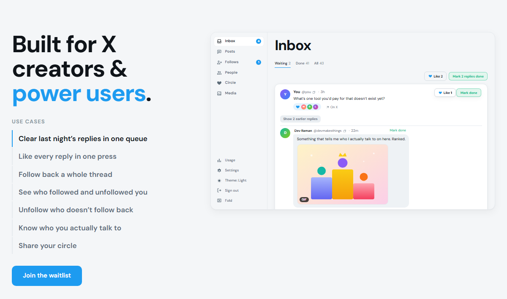

# xtoolio

Built for X creators and power users. Every reply, mention and quote of your posts as an inbox, one card per
conversation, waiting until you mark it done; like them all in one press, reply from the card. Who followed and
unfollowed you, who doesn't follow you back, and following back a whole thread. Everyone you go back and forth with,
ranked, with every conversation you've had with each, and your circle to share. Connect your own AI agent (anything
that speaks MCP) to read all of it and leave draft replies for you to send.



This is the code behind **[xtoolio.com](https://xtoolio.com)**, published so you can see exactly how it works and
what it charges (the billing is in `services/balance.js` and `services/billing.js`). Pay as you go there: X's own API
price plus a 50% markup (15% after the first $50 of markup each month), no subscription. Or run your own copy: you pay X directly, and as the owner of your own X developer
app your own posts, mentions and likes are read at X's owner rate. It takes an evening to set up.

**It's published as releases** (each a tagged snapshot of the code xtoolio.com runs, which may be ahead of the latest
one), **and it's not a supported product:** running your own is up to you, and issues may not get a reply.

## How it works

- **Sign in with X** (OAuth 2.0 with PKCE). It asks X to read, and for the writes its buttons make (like, repost,
  reply with pictures, follow); it writes only when you press one. It never reads DMs.
- **Four parts, each on its own:** the Inbox, People, Likes and Follows, priced separately, in any combination. Or
  **Likestorm only**: like someone's latest posts in one press, with nothing synced in between, paid per storm.
- **A first read** (a day or a week of your history, priced before it runs; Your circle can read further back later,
  up to X's latest 3,200 posts and 800 mentions; the Inbox opens on your newest 20 replies), then a **sync every 15
  minutes**, and **Live**: X's
  activity stream pushes replies to your posts, likes and
  follows of you within seconds (not every one: X skips some likes, and never sends a reply further down your thread, so
  while the app is open your mentions are also read every 30 seconds). Live needs an always-on machine: what X pushed
  while nothing was connected is gone (X can't replay it); the catch-up sync on reconnecting reads back posts, replies
  and mentions, but follows and unfollows from that stretch stay missing. All of it is on by default; an account can
  turn off **Keep syncing live** (the Inbox, Settings) to stop after an hour without the app open and be asked before
  catching up.
- **Every read is metered.** A ledger records what each run read and what X charges for it, and X's real credit
  balance is read once a minute, so you can see exactly where the money goes (`/usage`).
- **Optional prepaid billing** (Stripe): how xtoolio.com charges, X's cost × a multiplier from a prepaid balance,
  published so the pricing can be checked. Off by default. (The licence below doesn't allow running it as a competing
  paid service.)

## Stack

Node 22+, Express 5, Handlebars (server-rendered, no build step), plain JavaScript, MongoDB with Mongoose. A strict
Content Security Policy (scripts and styles from the site only), session-bound CSRF tokens on every form (`csrf-csrf`),
X tokens sealed at rest with AES-256-GCM. Fifteen runtime dependencies.

It's built with [Claude Code](https://claude.com/claude-code). `CLAUDE.md` is the short guide to working on it (for
people and coding agents alike); `docs/` has the design of the bigger parts (billing, Live, the modules).

## Run your own

You need:

- **An X developer account on pay-per-use**, with prepaid credits (X bills per post and profile read).
- **A MongoDB database** (MongoDB Atlas works; give the app a user that can read and write only its own database).
- **Node 22 or newer.**

1. **Create an X app** in the X developer console. Under User authentication settings: Web App, app permissions
   "Read and write" (every sign-in asks for the writes the buttons use), callback URL
   `http://127.0.0.1:3100/auth/x/callback`.
   Copy its OAuth 2.0 Client ID and Client Secret, and, for Live, its Bearer Token.
2. **Configure:**
   ```sh
   npm install
   cp .env.example .env
   ```
   Fill in `.env`: `MONGO_URI`, `X_CLIENT_ID`, `X_CLIENT_SECRET`, `X_BEARER_TOKEN` (optional: Live),
   `SESSION_SECRET` and `TOKEN_KEY` (the file says how to generate them), `ALLOWED_USERNAMES` (your X user id),
   and `X_APP_OWNER_ID` (your X user id: your own reads are then priced at X's owner rate, and `/usage` shows X's
   real balance). Give your copy its own name with `BRAND_NAME` (and `LEGAL_ENTITY` for its Terms and Privacy pages).
   Every setting is explained in `.env.example`.
3. **Run:**
   ```sh
   npm start
   ```
   Open **http://127.0.0.1:3100** (that exact address: the sign-in cookie and X's callback live on it) and sign in with
   X. The start page asks how far back to read, each option priced first; the parts can be switched off in Settings.

### In production

- `pm2 start ecosystem.config.js` runs two processes: `xtoolio-web` serves pages, `xtoolio-worker` runs the syncs, Live
  and the balance clock.
- Put it behind HTTPS (nginx, for example: `deploy/nginx-xtoolio.conf`), set `APP_ORIGIN` to the public address,
  `HOST`/`PORT` to match, and register `APP_ORIGIN/auth/x/callback` in X's console. `TRUST_PROXY` says how many
  proxies sit in front (1, nginx, by default); set it to 0 if nothing does, or a visitor could fake their address
  past the rate limits.
- Live pages hold a server-sent events connection at `/live`: turn proxy buffering off for it, and serve HTTP/2
  (HTTP/1.1 allows six connections per host, and each open tab holds one).

### Tests

```sh
npm run verify      # no network, no database: people and threads, the security stack, the billing rules
npm run verify:db   # the money moves, deletion, privacy, the Inbox's start, the waitlist and its DMs against a TEST
                    # database: it creates and deletes accounts
```

## What it costs to run

X's pay-per-use price list is in `lib/pricing.js`: about $0.005 a post and $0.01 a profile, each billed once per UTC
day however often it's read, and $0.001 for the app owner's own posts, mentions and likes. A sync that finds nothing
new costs nothing beyond your own profile, which it re-reads every run and X bills once a day. `/usage` shows every run
that cost something and every day's real spend.

## License

[FSL-1.1-ALv2](LICENSE.md), the Functional Source License. You can read, run, change and share this code for any
purpose except offering it to others as a competing commercial product or service. Running it for yourself, or inside
your own company, is fine. Two years after each version is published, that version also becomes available under the
Apache License 2.0.

That makes it source-available, not open source by the OSI's definition.

## Contributing and security

Issues are welcome, with no promise of a reply. Pull requests aren't accepted.

Found a security problem? Please report it privately: see [SECURITY.md](SECURITY.md).
